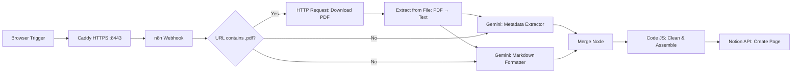

# 🚀 Agentic Job & PhD Application Tracker (n8n + Gemini AI + Notion)

An open-source, local agentic automation pipeline that captures job advertisements from web portals (LinkedIn, StepStone, Xing, Workday, university sites) **and PDF job postings** with a 1-click browser bookmarklet, Tampermonkey userscript, or Chrome extension. The content is cleaned and structured by Google Gemini AI and saved as a card in a custom Kanban tracker in Notion.


---

## 📌 Features & System Architecture

- **1-Click Web Capture:** Capture job details from any webpage using a lightweight browser bookmarklet, Tampermonkey userscript, or Chrome extension.
- **📄 PDF Job Posting Support:** Many university and research-institute vacancies are published only as PDFs. When the captured URL points to a `.pdf`, n8n downloads the file itself, extracts its text, and feeds it into the same AI pipeline as HTML pages.
- **Automatic Source Routing:** An `If` node inspects the incoming URL and routes the request either to the PDF branch (download → text extraction) or directly to the AI nodes with the page text sent by the browser.
- **Local HTTPS Reverse Proxy:** Built-in Caddy integration on `https://localhost:8443` to satisfy browser cross-origin (CORS) and mixed-content security rules.
- **Parallel LLM Pipeline:** Two parallel Google Gemini nodes (`gemini-3.1-flash-lite`, temperature `0`) independently extract structured metadata (JSON) and format the verbatim job description (Markdown).
- **Resilient Execution:** Both Gemini nodes retry automatically on failure (up to 5 attempts, 5 s apart), which absorbs rate limits and transient API errors on the free tier.
- **Robust Parsing:** A Merge node plus custom JavaScript cleans stray JSON syntax, code fences, escaped `\n` characters and leftover braces, and validates deadlines to strict `YYYY-MM-DD` before they reach Notion.
- **Smart Card Titles:** Cards are titled `🎓 Position - University` for PhD/academic roles and `💼 Position - Company` for industry roles.
- **Dossier & Checklist Automation:** Each card gets an application checklist tailored to the position type (**PhD / Academic** vs. **Industry**) plus an interview-preparation section.
- **Automated Windows Launch Pipeline:** `Start_n8n.bat` handles dependency management (Winget auto-install for Caddy), Docker Desktop initialization, process detachment, and HTTP polling before opening the dashboard.



---

## 📁 Repository Structure

```text
agentic-job-tracker-n8n/
├── .gitignore          # Excludes local Docker data and sensitive files
├── LICENSE             # MIT License
├── README.md           # Project documentation and setup guide
├── Start_n8n.bat       # Automated launcher script for Windows
└── workflow.json       # Exported n8n workflow file (HTML + PDF pipeline)
```

---

## 🛠️ Prerequisites

1. **Docker Desktop** installed on Windows, macOS, or Linux.
2. **Notion account** with a Kanban database created.
3. **Google Gemini API key** (free tier via [Google AI Studio](https://aistudio.google.com/)).
4. *(Recommended)* **Tampermonkey** browser extension with both userscripts installed: one for web job pages and one for PDF job postings (see Option B).

---

## 🚀 Step-by-Step Setup Guide

### 1. Notion Database & Integration Setup

1. Create a **Board View** database in Notion named **Application Tracker** with these properties (names must match exactly, since the workflow maps to them):

   | Property | Type | Filled by |
   | --- | --- | --- |
   | `Title` | Title | Workflow |
   | `Company / University` | Text | Workflow |
   | `Job Type` | Select (`Industry`, `PhD`) | Workflow |
   | `Application Deadline` | Date | Workflow (if stated in the ad) |
   | `Contact Person / Professor` | Text | Workflow |
   | `Contact / Professor Email` | Email | Workflow |
   | `Job Link` | URL | Workflow |
   | `Submitted Documents` | Files & media | You (manually) |

2. Go to [Notion My Integrations](https://www.notion.so/my-integrations) and create an integration named `Application Tracker Automation`.
3. Copy the **Internal Integration Secret** token (`secret_...`).
4. Open your Notion database page, click `...` (top right) → **Connect to** → select `Application Tracker Automation`.

### 2. Launching the Local Pipeline (Windows)

Double-click `Start_n8n.bat` in the project directory. The script will automatically:

1. Verify Caddy is installed (auto-installs via `winget` if missing).
2. Check and start Docker Desktop if the daemon is offline.
3. Spin up the `n8n` Docker container.
4. Launch Caddy in detached daemon mode, mapping `https://localhost:8443` → `http://localhost:5678`.
5. Poll `http://localhost:5678` until n8n is live, wait an 8-second buffer with dot indicators, and open your browser.

> [!NOTE]
> **Session SSL trust:** On first startup, visit `https://localhost:8443` in your browser. If you see *"Your connection is not private"*, click **Advanced → Proceed to localhost (unsafe)** once to trust Caddy's local certificate.

### 3. Importing the Workflow

1. Open `https://localhost:8443` in your browser.
2. Click **Workflows → Import from File** and select `workflow.json`.
3. Configure credentials:
   - **Gemini - Metadata Extractor** and **Gemini - Markdown Formatter:** add your Google Gemini API key.
   - **Create a database page (Notion):** add your Notion Internal Integration Secret and select your **Application Tracker** database.
4. Open the **Webhook** node and copy its **Production URL**. Replace `localhost:5678` with `localhost:8443` and use it wherever this README says `YOUR-PRODUCTION-WEBHOOK-ID`.
5. Toggle the workflow to **Active / Published** in the top right corner.

---

## ⚙️ How the Workflow Processes a Capture

| Step | Node | What it does |
| --- | --- | --- |
| 1 | **Webhook** | Receives `{ url, html, is_pdf }` from the browser. |
| 2 | **If** | Checks whether `url` contains `.pdf`. |
| 3a | **HTTP Request - Download PDF** | *(PDF branch)* Downloads the PDF from the posting URL as a binary file. |
| 3b | **Extract from File - PDF to json** | *(PDF branch)* Extracts the PDF's text content. |
| 4 | **Gemini - Metadata Extractor** | Returns JSON with company/university, job title, type, deadline, contact person and email. |
| 4 | **Gemini - Markdown Formatter** | Reformats the full advertisement verbatim into Notion-ready Markdown. |
| 5 | **Merge** | Waits for both Gemini nodes to finish. |
| 6 | **Code in JavaScript** | Cleans the AI output, validates the deadline, builds the title and assembles the page body (ad text, checklist, interview prep). |
| 7 | **Create a database page** | Creates the Notion card with properties and Markdown content. |

Both Gemini nodes read their input from the PDF text if it exists, otherwise from the page text sent by the browser, so HTML and PDF postings produce identical Notion cards.

---

## 🔖 Client Capture Methods

### Option A: Standard Bookmarklet (General HTML Sites)

Create a new browser bookmark named `💼 Save Job to Notion` and paste this script into the **URL / Location** field:

```javascript
javascript:(function(){const u='https://localhost:8443/webhook/YOUR-PRODUCTION-WEBHOOK-ID';const t=document.body?(document.body.innerText||document.body.textContent):'';if(!t||t.trim().length<50){alert('⚠️ Could not extract job content.');return;}fetch(u,{method:'POST',headers:{'Content-Type':'application/json'},body:JSON.stringify({url:window.location.href,html:t})}).then(r=>{if(r.ok)alert('✅ Job successfully sent to Notion!');else alert('⚠️ Failed to send (Status: '+r.status+')');}).catch(e=>alert('❌ Error connecting to n8n: '+e.message));})();
```

Replace `YOUR-PRODUCTION-WEBHOOK-ID` with your active n8n webhook path.

> [!NOTE]
> Bookmarklets generally do not work inside the browser's built-in PDF viewer, and they are blocked on sites with strict CSP. Use the Tampermonkey scripts in Option B for those cases.

---

### Option B: Tampermonkey Userscripts (Recommended: Strict-CSP Sites & PDFs)

Some portals (e.g., IWM Tübingen, StepStone, LinkedIn) enforce strict **Content Security Policy (CSP)** headers that block bookmarklet `fetch()` requests to `localhost`. Tampermonkey bypasses these restrictions with background `GM_xmlhttpRequest` calls.

The project uses **two separate userscripts**, and both need to be added to Tampermonkey:

| Script | Use it for | Menu command |
| --- | --- | --- |
| **💼 Universal Job Scraper to n8n** | Job postings shown as normal web pages | 💼 Save Job to Notion |
| **💼📝 Send Job PDF to Notion** | Job postings published as PDF files | 📄 Send Job PDF to Notion |

**Installation (for each script):**

1. Install [Tampermonkey for Chrome](https://chromewebstore.google.com/detail/tampermonkey/dhdgffkkebhmkfjojejmpbldmpobfkfo).
2. Click the Tampermonkey icon → **Create a new script**, delete the template, and paste the script code.
3. Replace `YOUR-PRODUCTION-WEBHOOK-ID` with your active n8n webhook path and save (`Ctrl + S`).
4. Repeat for the second script.

Once both are installed, the Tampermonkey menu shows both commands on every page. Pick the one that matches what you are looking at.

#### B1. Universal Job Scraper (Web Pages)

Reads the rendered text of the current job page and sends it to n8n together with the page URL. Use this on LinkedIn, StepStone, Xing, Workday, company career pages and university job pages.

```javascript
// ==UserScript==
// @name         💼 Universal Job Scraper to n8n
// @namespace    http://tampermonkey.net/
// @version      1.0
// @description  Bypasses CSP restrictions and sends rendered job page text to n8n
// @match        *://*/*
// @grant        GM_xmlhttpRequest
// @grant        GM_registerMenuCommand
// ==/UserScript==

(function() {
    'use strict';

    function sendJobToN8n() {
        const webhookUrl = 'https://localhost:8443/webhook/YOUR-PRODUCTION-WEBHOOK-ID';
        const pageText = document.body ? (document.body.innerText || document.body.textContent) : '';

        if (!pageText || pageText.trim().length < 50) {
            alert('⚠️ Could not extract job content from this page.');
            return;
        }

        GM_xmlhttpRequest({
            method: 'POST',
            url: webhookUrl,
            headers: {
                'Content-Type': 'application/json'
            },
            data: JSON.stringify({
                url: window.location.href,
                html: pageText
            }),
            onload: function(response) {
                if (response.status >= 200 && response.status < 300) {
                    alert('✅ Job successfully sent to Notion!');
                } else {
                    alert('⚠️ Failed to send (Status: ' + response.status + ')');
                }
            },
            onerror: function(error) {
                alert('❌ Error connecting to n8n via Tampermonkey.');
            }
        });
    }

    // Register a menu item in Tampermonkey's extension popup
    GM_registerMenuCommand("💼 Save Job to Notion", sendJobToN8n);
})();
```

**Usage:** open a job posting → Tampermonkey icon → **💼 Save Job to Notion**.

#### B2. PDF Job Sender (PDF Postings)

Many university and research-institute vacancies are published only as PDFs, where the page text is not available to a normal scraper. This script sends the PDF's URL instead (with `is_pdf: true`), and n8n downloads the file and extracts its text itself, so nothing depends on the browser's PDF viewer. An `isSending` guard prevents duplicate Notion cards from accidental double clicks.

```javascript
// ==UserScript==
// @name         💼📝 Send Job PDF to Notion
// @namespace    http://tampermonkey.net/
// @version      1.3
// @description  Sends PDF job posting URLs to n8n for server-side download and text extraction
// @match        *://*/*
// @grant        GM_xmlhttpRequest
// @grant        GM_registerMenuCommand
// ==/UserScript==

(function() {
    'use strict';
    let isSending = false; // Prevent duplicate network calls

    function sendPdfJobToN8n() {
        if (isSending) return;
        isSending = true;

        const webhookUrl = 'https://localhost:8443/webhook/YOUR-PRODUCTION-WEBHOOK-ID';
        const currentUrl = window.location.href;
        const pageText = document.body ? (document.body.innerText || document.body.textContent) : '';
        const isPdf = currentUrl.toLowerCase().includes('.pdf');

        GM_xmlhttpRequest({
            method: 'POST',
            url: webhookUrl,
            headers: { 'Content-Type': 'application/json' },
            data: JSON.stringify({
                url: currentUrl,
                html: isPdf ? "" : pageText,
                is_pdf: isPdf
            }),
            onload: function(response) {
                isSending = false;
                if (response.status >= 200 && response.status < 300) {
                    alert('✅ Job successfully sent to Notion!');
                } else {
                    alert('⚠️ Failed (Status: ' + response.status + ')');
                }
            },
            onerror: function() {
                isSending = false;
                alert('❌ Connection Error.');
            }
        });
    }

    GM_registerMenuCommand("📄 Send Job PDF to Notion", sendPdfJobToN8n);
})();
```

**Usage:** open the PDF job posting in your browser → Tampermonkey icon → **📄 Send Job PDF to Notion**.

---

### Option C: Chrome Webhook Extensions

Alternatively, install a Chrome extension such as [Webhook Manager](https://chromewebstore.google.com/detail/webhook-manager/bgmeeebkokmefcfafnhfjgbemifefbno) or **Webhooks for Chrome**. Set the target URL to `https://localhost:8443/webhook/YOUR-PRODUCTION-WEBHOOK-ID` with HTTP method `POST` to trigger the workflow outside page-level security policies.

---

## ⚡ Daily Usage Workflow

1. Double-click `Start_n8n.bat` to launch the background services.
2. Browse job vacancies on any portal, or open a PDF job posting in your browser.
3. Trigger the bookmarklet, or use the Tampermonkey menu: **💼 Save Job to Notion** for web pages, **📄 Send Job PDF to Notion** for PDFs.
4. Open Notion to view the new application card with extracted metadata, verbatim ad text, a targeted application checklist, and an interview-preparation section.
5. Press any key in the `Start_n8n.bat` command window to close the launcher while background services keep running.

---

## 🧯 Troubleshooting & Known Limitations

- **PDF must be publicly downloadable.** n8n downloads the PDF from its own container, without your browser's cookies or login session. PDFs behind a login, or local `file://` PDFs, cannot be fetched. For those, copy the text into a normal page or use a public link.
- **Scanned PDFs:** PDFs that contain only images have no text layer, so extraction returns little or nothing. OCR is not part of the current workflow.
- **PDF detection is URL-based.** The `If` node routes by checking whether the URL contains `.pdf` (case-sensitive). PDFs served from URLs without `.pdf` in them (e.g., `/download?id=123`) are treated as HTML pages.
- **Empty deadline in Notion:** the deadline is only set when the ad states one that Gemini can convert to `YYYY-MM-DD`; otherwise the card shows *Not Mentioned*.
- **Gemini errors / rate limits:** both AI nodes retry up to 5 times. If executions still fail, check your API quota in Google AI Studio.
- **`Status: 404` from the browser:** the workflow is not active, or the webhook ID in your script does not match the Webhook node's Production URL.

---

## 📄 License

Distributed under the MIT License. See [`LICENSE`](LICENSE) for more information.
